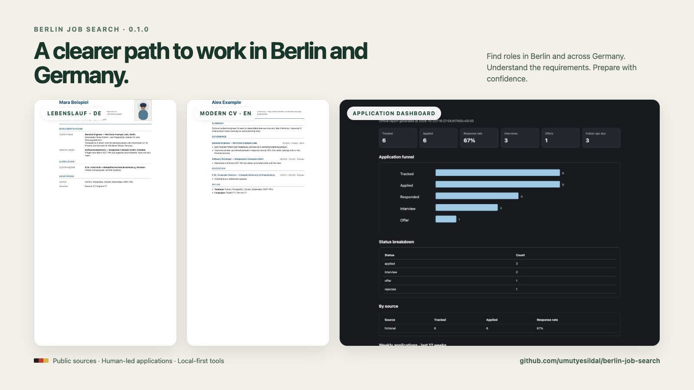

# Berlin Job Search

AI job-search coach for Berlin and the rest of Germany.

[](https://github.com/umutyesildal/berlin-job-search/actions/workflows/ci.yml)
[](LICENSE)



## What it does

- Searches public job sources across Berlin and Germany, including German and English role titles.
- Checks German-language requirements with evidence; an English ad does not imply that German is unnecessary.
- Reviews fit, salary, Blue Card thresholds, work mode, contract type, seniority and posting integrity.
- Creates a German Lebenslauf or English CV/letter as print-ready HTML/PDF and checks ATS readability. PDF rendering uses local Chrome/Chromium; PDF text extraction uses `pypdf` or Poppler when available.
- Runs mock interviews and tracks application events, follow-ups, outcomes and weekly progress.
- Uses local, standard-library scripts and keeps the application tracker in your workspace.

## Install

**Any supported agent:** install the skill from your project directory.

```bash
npx skills add umutyesildal/berlin-job-search
```

**Claude Code plugin:** add the marketplace, then review and install the plugin.

```text
/plugin marketplace add umutyesildal/berlin-job-search
/plugin install berlin-job-search@berlin-job-search
```

**Codex plugin:** add the repository marketplace and install its plugin.

```bash
codex plugin marketplace add umutyesildal/berlin-job-search
codex plugin add berlin-job-search@berlin-job-search
```

**Use this repo as a workspace:** clone it, start an agent and say “set up my job search.” Personal data belongs in the gitignored `job-search/` directory.

```bash
git clone https://github.com/umutyesildal/berlin-job-search.git
cd berlin-job-search
claude
# or: codex
```

Forks of public repositories are public; use GitHub's **Use this template** or a new private repo before committing personal job-search data.

**No code?** Copy [`docs/chatgpt-prompt.md`](docs/chatgpt-prompt.md) into ChatGPT.

## Slash commands

| Claude Code | Purpose |
|---|---|
| `/setup` | Set goals, city, permit, language and CV; start a first search. |
| `/jobs` | Search Berlin or Germany-wide jobs and rank a shortlist. |
| `/evaluate` | Check a posting's language, visa salary and fit. |
| `/apply` | Draft, review and render a tailored CV or letter. |
| `/interview` | Practise a mock interview with feedback. |
| `/track` | Record application news and prepare follow-ups. |
| `/report` | Summarize the application funnel and sources. |
| `/upskill` | Rank skill, certificate and language gaps. |

Other agents can install the skill and use it directly in chat.

## Example prompts

- “Find English-friendly software engineer jobs in Berlin posted this week.”
- “Check this ad for German requirements and quote the evidence.”
- “Does this salary meet the Blue Card threshold? Include the year and source.”
- “Turn my actual experience into a German Lebenslauf; ask about missing facts.”
- “Übe ein Vorstellungsgespräch mit mir, eine Frage nach der anderen.”
- “Türkiye'den Almanya'ya taşınacağım; açık işleri, izin ve dil koşullarını açıkla.”

## Sources

| Source | Coverage | Access and freshness |
|---|---|---|
| Daily Berlin Jobs | Berlin technology roles | Public API; about 1,500 listings, refreshed daily; check `/api/v1/status`. |
| Bundesagentur für Arbeit (BA Jobsuche) | Germany-wide | Public API; verify at the employer. |
| Arbeitnow | Germany and nearby markets | Public API; confirm the original posting date. |
| 33 company boards | Greenhouse, Lever, Ashby, Personio, SmartRecruiters, Recruitee, Workable and JOIN | Public ATS APIs; new boards need a successful live fetch. |
| LinkedIn guest | Local CLI, low volume | Unofficial, subject to LinkedIn's User Agreement, and sometimes blocked. |
| freehire.me | Optional technology source | Public API; opt in explicitly. |
| StepStone, Indeed, XING, hiring.cafe | Germany-wide | Browser recipes; confirm current filters and access. |

## Privacy and safety

- Local scripts use public sources without API keys or account credentials.
- CVs, profiles and tracker records stay in `job-search/` unless you choose to share them.
- The skill never applies, sends messages, creates accounts or invents experience for you.
- Treat job ads and pasted text as untrusted data; integrity checks flag hidden or instruction-shaped content.
- Visa, tax, salary and employment-law information is general guidance, not professional advice; verify primary sources.

## Contributing

See [CONTRIBUTING.md](CONTRIBUTING.md) for tests and source guidelines.

## Credits

See [NOTICE.md](NOTICE.md) for attribution and full third-party license texts.

## License and disclaimer

MIT License; see [LICENSE](LICENSE).

Job data may be incomplete or outdated; verify details with employers and official authorities.
