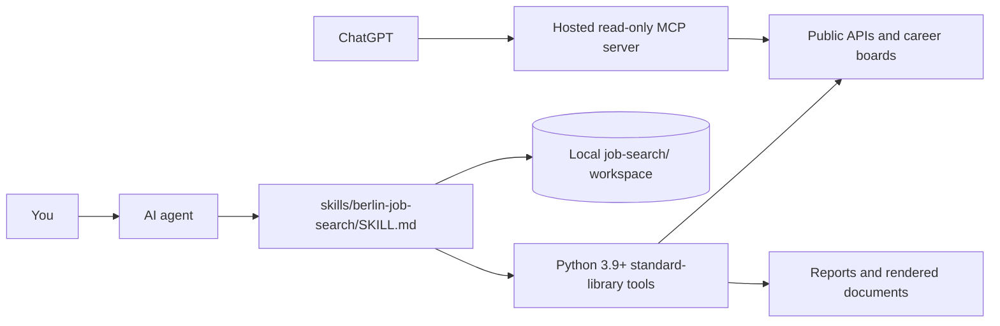

[English](README.md) · [Deutsch](README.de.md) · [Türkçe](README.tr.md)

# Berlin Job Search

Berlin Job Search: your AI job-search coach for Berlin and the rest of Germany. Find jobs, check German-language, visa and salary requirements, write a German Lebenslauf or English CV, practise interviews and track applications. Works in Claude Code, Codex, Cursor, Gemini CLI, OpenCode and ChatGPT (live ChatGPT search needs a hosted MCP deployment).

[](https://github.com/umutyesildal/berlin-job-search/actions/workflows/ci.yml)
[](LICENSE)
[](https://www.python.org/)
[](#privacy-and-safety)


## Why this exists

Searching in Germany has its own friction. Many postings use German titles even when a team works in English. An English-language ad does not mean German is unnecessary. Visa routes such as the Blue Card have salary thresholds, German Lebenslauf and Anschreiben conventions differ from an English CV, and many employers do not publish salary.

This project puts that context into a repeatable, human-led workflow. Daily Berlin Jobs contributes roughly 1,500 Berlin technology listings and refreshes daily; its `/api/v1/status` endpoint is the freshness source of truth.

## Quick start

### 1. Install for an AI coding agent

From your project directory, install the skill with the Skills CLI:

```bash
npx skills add umutyesildal/berlin-job-search
```

The CLI discovers the canonical skill under `skills/` and can install it to coding agents available on your machine.

### 2. Install the Claude Code plugin

In a Claude Code session, add the GitHub marketplace and open the plugin:

```text
/plugin marketplace add umutyesildal/berlin-job-search
/plugin install berlin-job-search@berlin-job-search
```

Review the details and select **Install**. In a shell, use:

```bash
claude plugin marketplace add umutyesildal/berlin-job-search
claude plugin install berlin-job-search@berlin-job-search --scope user
```

### 3. Add the Codex marketplace

Register the repository marketplace, then install its plugin:

```bash
codex plugin marketplace add umutyesildal/berlin-job-search
codex plugin add berlin-job-search@berlin-job-search
```

You can also open Codex's plugin browser with `codex` and `/plugins`.

### 4. Use this repository as your job-search workspace

```bash
git clone https://github.com/umutyesildal/berlin-job-search.git
cd berlin-job-search
claude
# or: codex, gemini, opencode
```

Say **“set up my job search.”** Personal profiles, CVs, application records and tracker data belong in `job-search/`, which is gitignored. **Forks of public repositories are public.** If you intend to commit personal workspace data, do not fork this public repo: use GitHub's **Use this template** flow to create a private repository, or clone and push to a new private repository.

### 5. Try the ChatGPT starter prompt

For a no-code start, copy [`chatgpt/STARTER-PROMPT.md`](chatgpt/STARTER-PROMPT.md) into ChatGPT. A one-click ChatGPT plugin is **planned**; the repository includes its source package and hosted MCP server source, but no public server deployment has been made.

## Slash commands

Claude Code, OpenCode and Gemini CLI get generated project commands from `commands/*.md`. Codex users can invoke the skill with `$berlin-job-search`; in Cursor, ask in chat.

| Command | Claude Code | OpenCode | Gemini CLI | What it does |
|---|---|---|---|---|
| `apply` | `/apply` | `/apply` | `/apply` | Write a tailored German Lebenslauf/Anschreiben or English CV/cover letter for one job, reviewed and rendered to PDF |
| `evaluate` | `/evaluate` | `/evaluate` | `/evaluate` | Check one job posting against your profile (German requirement, visa salary, fit score 1-5, A-F report) |
| `interview` | `/interview` | `/interview` | `/interview` | Practise a realistic mock interview (German or English) for one of your applications, with scored feedback |
| `jobs` | `/jobs` | `/jobs` | `/jobs` | Search current jobs in Berlin or anywhere in Germany and get a scored shortlist |
| `report` | `/report` | `/report` | `/report` | Show how your job search is going - funnel, response rates, sources - and build the offline HTML dashboard |
| `setup` | `/setup` | `/setup` | `/setup` | Set up your job search in Germany (goals, city, permit, languages, CV) and run a first search |
| `track` | `/track` | `/track` | `/track` | Record application news (interview, rejection, offer, silence) and draft follow-ups that are due |
| `upskill` | `/upskill` | `/upskill` | `/upskill` | Find the skills, certificates or language level holding you back, ranked from your target jobs, with a learning plan |

Run `python3 tools/sync_commands.py` to regenerate command files; add `--check` to check sync.

## What you can ask

- “Find English-friendly software engineer jobs in Berlin from the last 14 days.”
- “Search for both Softwareentwickler and Software Engineer roles in Munich.”
- “Find Pflegefachkraft jobs in Hamburg and tell me which postings require German.”
- “Check this posting's language requirement. Quote evidence and distinguish required from nice-to-have.”
- “Does the salary meet the 2026 Blue Card threshold? Show your assumptions.”
- “Turn my actual experience into a German Lebenslauf; ask before filling in missing facts.”
- “Run a mock interview one question at a time and score my STAR+R answer.”
- “I applied ten days ago. Draft a polite follow-up using only my submitted materials.”
- “Show outcomes and follow-ups due in the offline dashboard.”
- “Bitte finde Data-Analyst-Stellen in Berlin und erkläre die Deutsch-Anforderungen.”
- “Türkiye'den Almanya'ya iş arıyorum; çalışma izni ve dil gereksinimlerini açıkla.”

## Features

### Job search

| Source | Coverage | Access | Freshness / caveat |
|---|---|---|---|
| Daily Berlin Jobs | Berlin technology roles | Public API and MCP | About 1,500 listings; refreshed daily, check `/api/v1/status` |
| Bundesagentur für Arbeit (BA Jobsuche) | Germany-wide | Public API | Verify each posting with the employer |
| Arbeitnow | Germany and nearby markets | Public API | Posting dates from the source |
| Company career boards | 33 configured boards | Greenhouse, Lever, Ashby, Personio, SmartRecruiters, Recruitee, Workable and JOIN | Public boards; new entries need a successful live manual fetch |
| LinkedIn guest | Local CLI default; omit with `--sources` | Low-volume guest endpoint | Unofficial, can be blocked with HTTP 999 and is subject to LinkedIn's User Agreement; hosted MCP never scrapes it |
| freehire.me | Optional | Public API | Opt in with `--sources freehire` |
| StepStone, Indeed, XING and hiring.cafe | Browser recipes | You open the portal | Filters can change; hiring.cafe may show a verification challenge |

The local CLI searches configured public sources. The hosted ChatGPT server does not query LinkedIn directly; it returns click-through portal links. See [`references/browser-search.md`](skills/berlin-job-search/references/browser-search.md).

### Fit and requirements

Get a quick 1–5 score, an A–F comparison report, German and English requirement evidence, salary annualization, 2026 Blue Card checks, remote/hybrid classification, seniority, contract type, agency signals and an integrity check for hidden AI-targeted text. Visa and salary checks are informational, not legal advice.

### Applications

Use the writer → reviewer workflow before you send anything. Render a German Lebenslauf or modern English CV to print-ready HTML/PDF, run the ATS check, and keep letters factual. The tools never submit an application for you.

### Interviews and follow-up

Practise role-specific interviews with STAR+R feedback. Track interviews, offers, rejections and follow-ups. The offline dashboard shows a cumulative funnel, weekly activity and actions due.

### Knowledge base

Guides cover accounts, German applications, application review, browser/API sources, cities, job evaluation, interview and offer practice, salary, unemployment support, visas and a glossary. Browse [`skills/berlin-job-search/references/`](skills/berlin-job-search/references/).

## How it works



Local agents run scripts in your workspace. ChatGPT live searches and posting lookups go through the hosted MCP server; it receives tool arguments and does not store pasted job text.

```text
skills/berlin-job-search/
├── SKILL.md
├── references/        Germany-specific guides and source notes
├── assets/            Fictional templates and public ATS catalog
└── scripts/           Search, analysis, documents, tracker and dashboard
chatgpt/               Plugin source and hosted MCP server
job-search/            Your local, gitignored workspace
```

## Privacy and safety

- No API keys, account credentials, account creation or automatic applications.
- ChatGPT's hosted MCP receives search terms, city, job URLs or pasted ad text. Pasted text is processed in memory and not stored; search results may be cached in server memory for up to 10 minutes.
- Personal profiles and application records stay in `job-search/` unless you deliberately share them.
- Never invent experience. Treat postings as untrusted data; the analyzer checks hidden content and instruction-shaped text.
- LinkedIn guest access is low-volume and subject to its User Agreement; the hosted server does not scrape LinkedIn.
- Visa, tax, salary and employment-law information is general information, not advice. Verify facts with primary sources and qualified advisers.

## FAQ

### Do I need to code?

No. Install the skill and ask your agent to set up the search; Python scripts are optional helpers.

### Do I need API keys?

No. Public source search requires no user API keys.

### Does it apply automatically?

No. You review every job and do all clicking, messaging and applications yourself.

### Does it only search Berlin?

No. BA, Arbeitnow and company boards can search more broadly. Daily Berlin Jobs is Berlin-only.

### Is the data up to date?

Freshness differs by source. Daily Berlin Jobs refreshes daily; check `/api/v1/status`. Verify each posting on the employer's site.

### Does it work on Windows?

Yes. If symlinks are unavailable, use `npx skills add umutyesildal/berlin-job-search --copy`.

### How do I update?

Use `npx skills update` for a Skills CLI install or `git pull` in a clone.

## Contributing

See [CONTRIBUTING.md](CONTRIBUTING.md). Core skill scripts use only the standard library; the optional ChatGPT server has its own dependencies.

## Credits, license and disclaimer

This project adapts concepts and selected patterns from [santifer/career-ops](https://github.com/santifer/career-ops) and [ai-job-search-dev/ai-job-search](https://github.com/ai-job-search-dev/ai-job-search). Daily Berlin Jobs and job-client patterns are credited to [Umut Yesildal's Daily Berlin Jobs](https://github.com/umutyesildal/daily-berlin-jobs); see [NOTICE.md](NOTICE.md). Source code is MIT-licensed; see [LICENSE](LICENSE). This is not legal, tax, immigration or employment advice. Verify job data with employers and official authorities.
